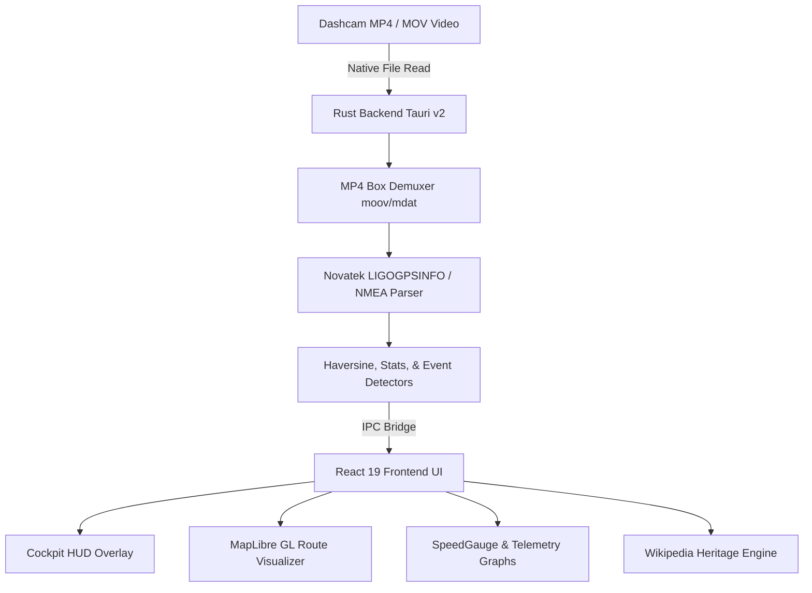
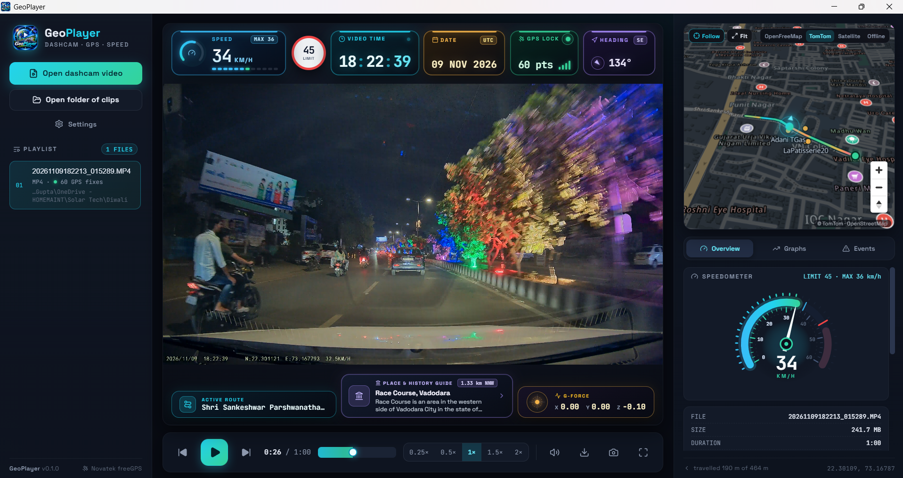
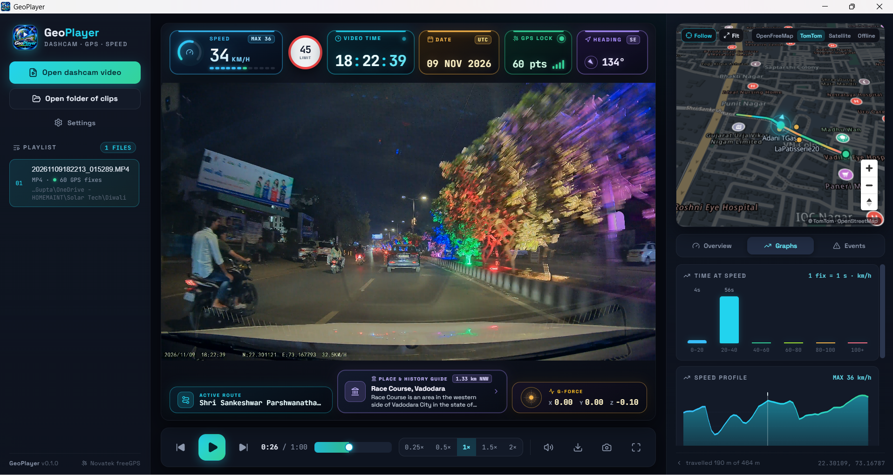
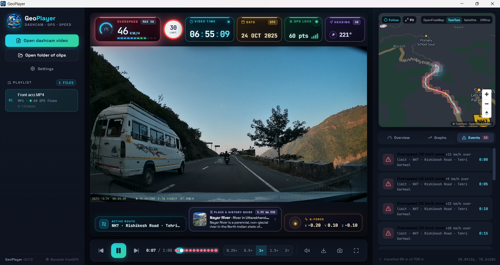
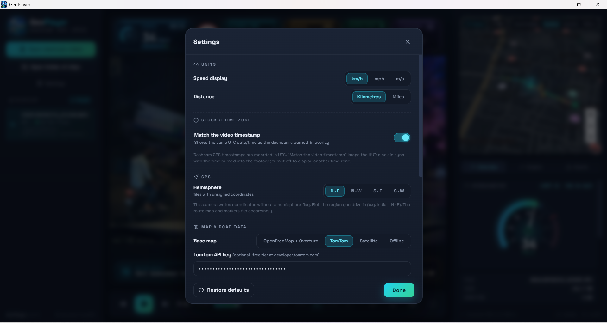
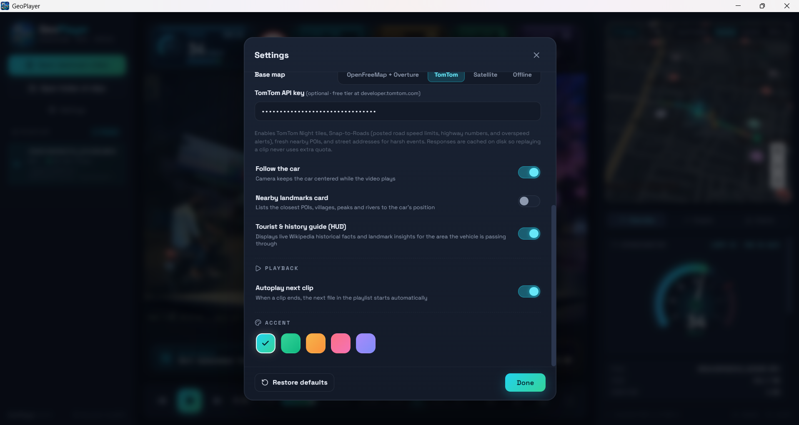

<div align="center">

# 🛰️ GeoPlayer

**Next-Gen Open-Source Dashcam Video Player with Embedded GPS Telemetry & Cockpit HUD**

[](https://opensource.org/licenses/MIT)
[](https://v2.tauri.app/)
[](https://react.dev/)
[](https://www.rust-lang.org/)
[](https://maplibre.org/)

*GeoPlayer is a high-performance cross-platform desktop dashcam video player designed to decode, visualize, and synchronize embedded GPS telemetry directly from dashcam MP4/MOV footage with zero third-party cloud uploads.*

[Features](#key-features) • [Screenshots](#screenshots--visual-tour) • [Quick Start](#quick-start) • [Architecture](#architecture) • [Telemetry Support](#telemetry-decoding-engine) • [Contributing](#contributing) • [License](#license)

</div>

---

## 📌 Overview & AI Search Keywords

> **Key Domains**: Dashcam Player, Embedded GPS Telemetry Decoder, Novatek freeGPS / LIGOGPSINFO parser, NMEA MP4 Demuxer, Automotive Cockpit HUD, MapLibre GL Vector Map, OpenFreeMap, TomTom Snap-to-Roads, G-Force Telemetry, Harsh Braking Event Detector, Open-Source Dashcam Telemetry Viewer.

Traditional media players only display video pixels. **GeoPlayer** penetrates MP4 container atoms (`moov`, `mdat`, `gps `, `freeGPS`) using a high-throughput **Rust engine**, pulling 1 Hz to 10 Hz GPS telemetry, Doppler speed, G-force vectors, and UTC timestamps. It renders an ultra-crisp, luxury automotive digital cockpit HUD, synchronized route maps, dynamic speedometers, and live contextual tourism/history insights.

---

## ✨ Key Features

### 🏎️ 1. Luxury Cockpit Instrument HUD
- **Analog + Digital Speedometer Cluster**:
  - 260° SVG radial tachometer with multi-color dynamic speed arc (Cyan → Emerald → Amber → Rose).
  - High-precision tabular digital readout with auto-clamped low-speed deadzones (`<3 km/h`).
  - 12-segment animated digital power bar and peak speed tracker.
  - Optional posted speed limit sign with active overspeed detection & pulsing alerts.
- **Microsecond Clock & GPS Lock**:
  - Live UTC/local synchronized timecode matching burned-in camera OSD.
  - Active satellite lock indicator with signal strength meter.
  - Dynamic gyro-compass with 16-point direction rose (`N`, `NE`, `SSE`, etc.).
- **Live G-Force Vector Ball**:
  - Tri-axis (X, Y, Z) lateral and longitudinal acceleration monitoring with dynamic physics damping.
- **Place & History Guide Card**:
  - Real-time Wikipedia geosearch integration displaying tourist facts, architectural heritage, and historical insights for the exact location you are driving through.

### 🗺️ 2. Multi-Provider Route & Mapping Engine
- **OpenFreeMap & Overture Places**: 100% keyless, privacy-preserving 3D vector night maps with PMTiles local spatial querying.
- **TomTom Night Navigation**: Snap-to-Roads API integration for road names, highway numbers (e.g. `NH-7`, `SH-12`), speed limits, and nearby POIs with disk caching.
- **Esri Satellite Hybrid**: High-resolution aerial satellite imagery with crisp vector road overlays.
- **Zero-Network Offline Schematic Mode**: Standalone Canvas 2D telemetry vectorizer when no internet connection is available.
- **Interactive Route Seeking**: Click anywhere along the GPS route line on the map to jump video playback directly to that coordinate.

### 📊 3. Driving Telemetry Analytics & Harsh Events
- **Telemetry Charts**: Real-time speed profiles, cumulative distance tracking, and G-force history.
- **AI-Style Harsh Event Detection**:
  - Automatic detection of emergency braking, harsh deceleration, sharp cornering, and rapid acceleration.
  - Instant jump-to-event bookmarks with reverse-geocoded street names.
- **One-Click GPX Track Export**: Export pure standard GPX tracks with timestamps and elevation for Garmin, Google Earth, Strava, or QGIS.

### 🎥 4. High-Performance Video Player
- Native hardware decoding via WebView2 (DirectX 12 / DirectShow / Media Foundation).
- Mouse-wheel smooth digital zoom up to `5×` with draggable viewport panning.
- Frame-stepping (`.` and `,`), multi-speed playback (`0.25×` to `2.0×`), and native OS drag-and-drop playlist support.

---

## 🛠️ Architecture & Tech Stack



- **Backend**: Rust 1.85+, Tauri v2, `chrono`, `serde`, `reqwest` (TLS proxy & caching).
- **Frontend**: React 19, TypeScript 5.8+, Vite 8, MapLibre GL 5.6+, PMTiles 4.5+, Lucide Icons.
- **Styling**: Vanilla CSS3 design system with hardware-accelerated glassmorphism, responsive clamp typography, and custom dark mode themes.

---

## 🚀 Quick Start

### Prerequisites
- **Node.js**: v20 or v22+
- **Rust**: `1.85+`
- **C/C++ Build Tools**: MinGW-w64 (GCC) or MSVC Build Tools

### Installation & Development

```bash
# 1. Clone the repository
git clone https://github.com/homemaint/geoplayer.git
cd geoplayer

# 2. Install dependencies
npm install

# 3. Launch in development mode (Vite HMR + Tauri Debug Window)
npm run tauri dev
```

### Production Build

```bash
# Build the optimized frontend bundle
npm run build

# Build the native desktop binary (installer / standalone .exe)
npm run tauri build
```

> **Windows Note (Paths with spaces)**: If your local directory path contains spaces (e.g. `D:\My Projects\...`), MinGW's `windres` requires running from a spaceless path or directory junction (e.g. `cmd /c mklink /J D:\geoplayer "D:\My Projects\Geoplayer"`).

---

## 📸 Screenshots & Visual Tour

<div align="center">

### 1. Main Cockpit HUD & Synchronized Map Replay
*Luxury automotive instrument cluster, posted speed limit sign, microsecond clock, GPS satellite lock, heading gyro, vector map replay, and precision analog speedometer.*



<br/>

### 2. Driving Telemetry Analytics & Speed Graph
*Interactive speed profile chart with max speed tracking, distance traveled, and time-synchronized telemetry scrubbing.*



<br/>

### 3. Harsh Driving Event Detection
*Automated forensic detection of emergency braking, harsh deceleration, sharp turns, and rapid acceleration with direct jump-to-event seeking.*



<br/>

### 4. Comprehensive Application & Telemetry Settings
*Configurable speed/distance units, clock synchronization, hemisphere calibration, map providers (OpenFreeMap, TomTom, Esri, Offline Schematic), and tourist guide options.*

| Units, Clock & GPS Settings | Map Styles & Road Data Settings |
|:---:|:---:|
|  |  |

</div>

---

## 🛰️ Telemetry Decoding Engine

GeoPlayer includes a native Rust port of the forensic `LIGOGPSINFO` specification:
- Decodes digit-cipher enciphered blocks used by Novatek NT966xx series processors.
- Automatic fuzz-scale estimator based on Doppler speed comparison.
- Full NMEA sentences embedded in QuickTime atoms or text sidecar files (`.nmea`, `.gps`, `.log`).
- Decodes tri-axis accelerometer spikes to identify collision or hard cornering points.

---

## ⌨️ Keyboard Shortcuts

| Shortcut | Action |
|:---|:---|
| <kbd>Space</kbd> / <kbd>K</kbd> | Play / Pause |
| <kbd>→</kbd> / <kbd>←</kbd> | Seek forward / backward 5 seconds |
| <kbd>.</kbd> / <kbd>,</kbd> | Single frame advance / rewind |
| <kbd>F</kbd> | Toggle Fullscreen |
| <kbd>M</kbd> | Mute / Unmute audio |
| <kbd>Scroll Up/Down</kbd> | Zoom video up to 5× |
| <kbd>Drag Video</kbd> | Pan zoomed video viewport |
| <kbd>N</kbd> / <kbd>P</kbd> | Next / Previous video in playlist |

---

## 🗺️ Roadmap

- [x] Embedded Novatek freeGPS extraction & coordinate de-fuzzing
- [x] Multi-provider Vector Map (OpenFreeMap + TomTom + Esri)
- [x] Real-time Wikipedia Tourist & Heritage Guide Card
- [x] 60 FPS critically-damped analog & digital gauge cluster
- [ ] Direct export of video with burned-in HUD graphics (FFmpeg render pipeline)
- [ ] GoPro GPMF and BlackVue telemetry parser support
- [ ] Dual-channel (Front + Rear camera) synchronized split playback

---

## 🤝 Contributing

Contributions are welcome! Please feel free to submit issues, pull requests, or telemetry sample files from different dashcam models.

1. Fork the Project
2. Create your Feature Branch (`git checkout -b feature/AmazingFeature`)
3. Commit your Changes (`git commit -m 'Add some AmazingFeature'`)
4. Push to the Branch (`git push origin feature/AmazingFeature`)
5. Open a Pull Request

---

## 📄 License

Distributed under the **MIT License**. See [`LICENSE`](LICENSE) for more information.

---

<div align="center">
Built with ❤️ for automotive enthusiasts, dashcam reviewers, and open-source forensics.
</div>
